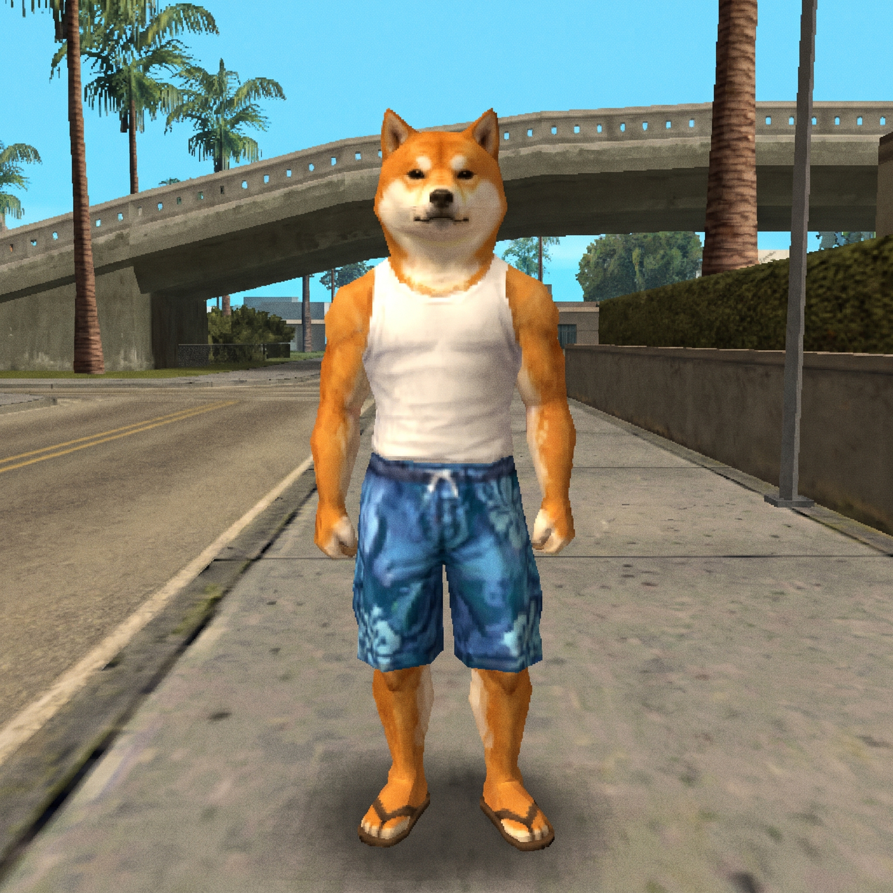

# Next task: GTA San Andreas-style graphics

**Goal:** make Doge look like the reference picture below: a real 3D model with painted textures (fur, white tank top, blue flower shorts, flip-flops). Right now he's built from coloured blocks in code.

Start with **Doge only**. If that works well, do the same for cops, gang members, the dancers and the cars.

## Steps

1. **Make the 3D model from the picture.**
   - Use an AI image-to-3D tool like [Meshy](https://www.meshy.ai) or [Tripo](https://www.tripo3d.ai), and upload the reference picture.
   - Ask for a low-poly, game-ready model, 5,000–15,000 triangles, so it runs on phones.
   - Download it as **GLB**.

2. **Make it walk.**
   - Upload the model to [Mixamo](https://www.mixamo.com) (free with an Adobe account). It adds a skeleton automatically.
   - Download these animations **with skin**, as FBX:
     - Idle
     - Walking
     - Running
     - Pistol idle / aiming
     - Punch
     - Death
   - Combine them into one GLB. Blender works for this, or [gltf.report](https://gltf.report).

3. **Check the file.**
   - Keep it under about 5 MB.
   - Make sure the textures are baked in.
   - Name the file `doge.glb` and put it in the repo next to `index.html`.

4. **Load it in the game.** Tell Claude (or do it yourself):
   - Load `doge.glb` with Three.js `GLTFLoader` (the game uses three.js r128, so use the matching `GLTFLoader.js` from a CDN).
   - Play the animations with `AnimationMixer` (idle / walk / run based on speed, aim when shooting).
   - Attach the gun to the right-hand bone.
   - Keep the current block Doge as a backup if the model fails to load.
   - Put the outfits (Beach Bum, Ski Mask, Drip) on the new model. Either make 3 model versions, or swap textures.

## Making the world look closer to San Andreas

These are optional, after Doge:
- Use photo-style textures for roads, pavements and buildings instead of the flat pixel ones.
- Add an orange evening sky with the sun lower and warmer.
- Add simple shadows under buildings and cars.
- Add an overpass or bridge and some taller palm trees, like in the picture.

## Things to watch

- **Phones and Telegram:** check performance after each model you add. If it gets slow, lower the triangle count or texture size.
- **One GLB per character type:** reuse it for all cops or gang members instead of loading many files.
